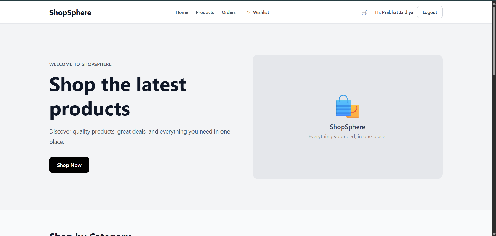
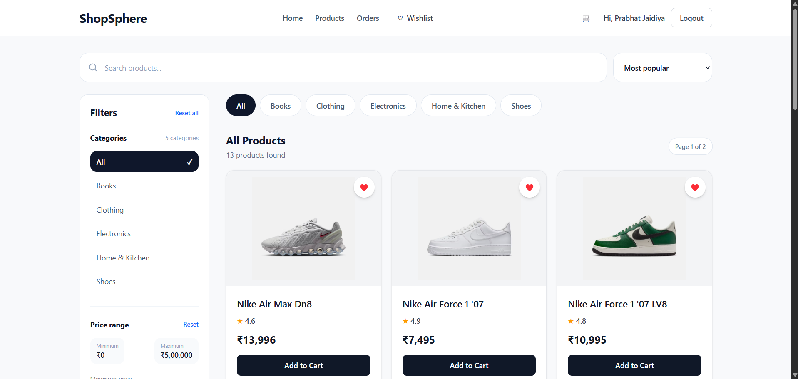
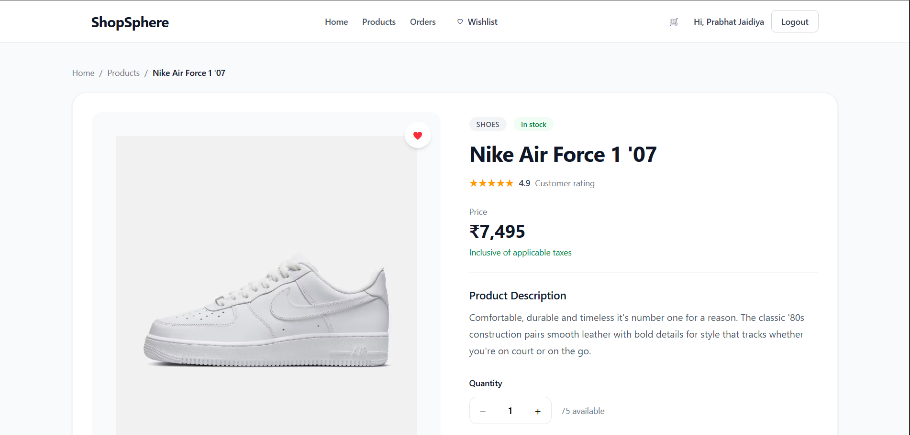
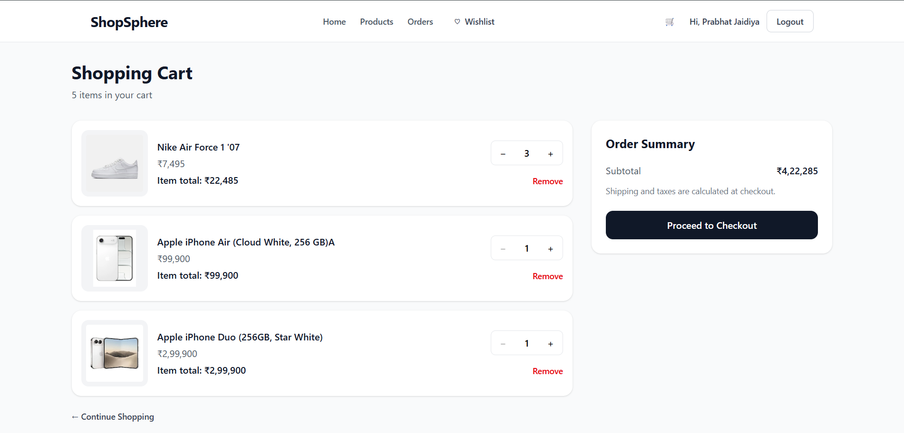
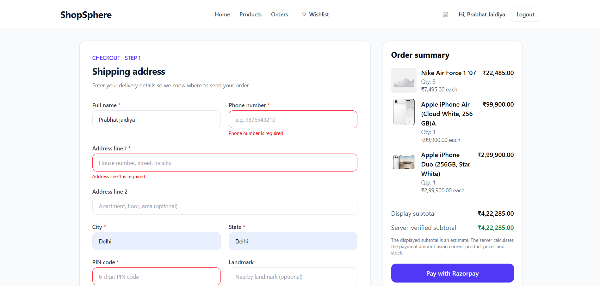
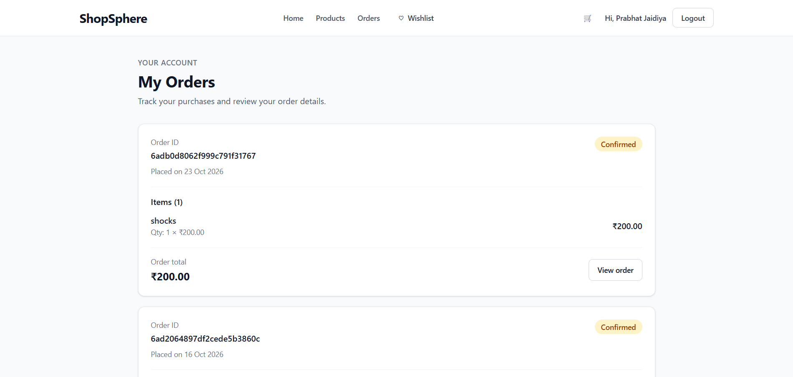
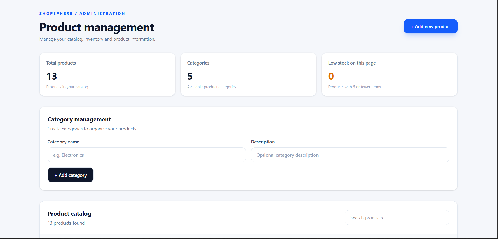
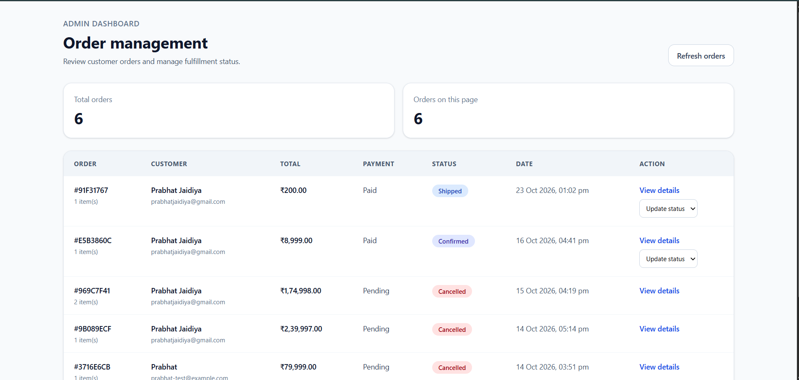
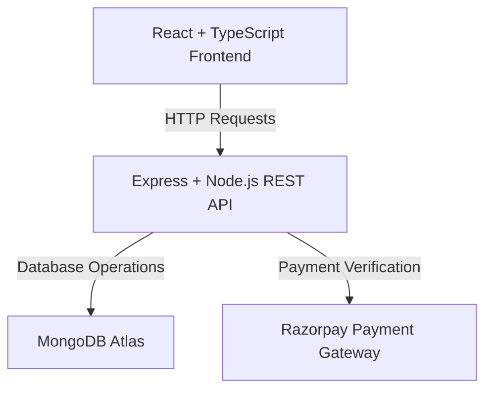

# ShopSphere — Full-Stack E-Commerce Platform

A full-stack e-commerce application built with React, TypeScript, Node.js, Express, and MongoDB. ShopSphere provides a complete online shopping experience with secure authentication, product discovery, cart management, checkout, Razorpay payments, order tracking, and an admin dashboard.

<p align="center">
  <a href="https://shopsphere-coral-rho.vercel.app/">
    <strong>🚀 Live Demo</strong>
  </a>
  &nbsp; | &nbsp;
  <a href="https://github.com/prabhatjaidiya/shopsphere">
    <strong>📂 GitHub Repository</strong>
  </a>
</p>

---

## 📸 Screenshots

### Home Page



### Product Listing



### Product Details



### Shopping Cart



### Checkout



### Customer Orders



### Admin Product Management



### Admin Order Management



> Replace the screenshot paths above with your actual screenshot filenames. If your screenshots are stored in another directory, update the paths accordingly.

---

## ✨ Features

### Customer Experience

- User registration and login
- JWT-based authentication
- Product browsing and product details
- Category-based product filtering
- Product search and sorting
- Price range filtering
- Product ratings and reviews display
- Shopping cart with quantity management
- Wishlist functionality
- Shipping address management
- Checkout and order creation
- Razorpay payment integration
- Customer order history
- Order details and status tracking
- Responsive user interface

### Admin Dashboard

- Protected admin routes
- Role-based authorization
- Product management (CRUD)
- Category management
- Inventory and stock management
- Admin order management
- Order status updates
- Customer order overview

### Security and Validation

- Password hashing with bcrypt
- JWT authentication
- Protected backend routes
- Admin-only API authorization
- Input validation and sanitization
- Security headers and CORS configuration
- Rate limiting for sensitive routes
- Server-side payment verification
- Duplicate payment verification protection
- Server-side price and stock validation

---

## 🛠️ Tech Stack

| Technology | Purpose |
|---|---|
| React | Frontend UI |
| TypeScript | Type safety |
| Vite | Frontend development and build |
| Tailwind CSS | Styling |
| React Router | Client-side routing |
| TanStack Query | Server-state management |
| Node.js | Backend runtime |
| Express.js | REST API |
| MongoDB | Database |
| Mongoose | MongoDB ODM |
| JWT | Authentication |
| bcrypt | Password hashing |
| Razorpay | Payment gateway |
| Vercel | Frontend deployment |
| Render | Backend deployment |

---

## 🏗️ Architecture

ShopSphere follows a client-server architecture.



### Application Flow

1. The customer interacts with the React frontend.
2. The frontend sends HTTP requests to the Express API.
3. The backend validates requests and authenticates users.
4. MongoDB stores users, products, carts, and orders.
5. Razorpay handles payment processing.
6. The backend verifies payment details before confirming an order.

### Authentication and Authorization

ShopSphere uses JWT-based authentication.

- Customers access their own cart, wishlist, and orders.
- Protected routes require authentication.
- Admin routes require an authenticated admin user.
- Backend authorization ensures customers cannot access admin-only operations.
- Payment verification is performed on the server.

---

## 📁 Project Structure

The application is organized into frontend and backend applications.

```text
ShopSphere/
├── frontend/
│   ├── src/
│   │   ├── components/
│   │   ├── pages/
│   │   ├── hooks/
│   │   ├── services/
│   │   ├── context/
│   │   ├── types/
│   │   └── ...
│   ├── public/
│   ├── package.json
│   └── ...
│
├── backend/
│   ├── src/
│   │   ├── controllers/
│   │   ├── routes/
│   │   ├── models/
│   │   ├── middleware/
│   │   ├── config/
│   │   ├── utils/
│   │   └── ...
│   ├── package.json
│   └── ...
│
├── docs/
│   ├── API.md
│   └── ARCHITECTURE.md
│
├── screenshots/
└── README.md
```

> Adjust this structure to match the actual folders in your repository.

---

## ⚙️ Getting Started

Follow these instructions to run ShopSphere locally.

### Prerequisites

Install the following:

- Node.js
- npm
- Git
- MongoDB Atlas account or local MongoDB instance
- Razorpay account for payment testing

### 1. Clone the Repository

```bash
git clone https://github.com/prabhatjaidiya/shopsphere.git

cd shopsphere
```

### 2. Install Backend Dependencies

```bash
cd backend

npm install
```

### 3. Configure Backend Environment Variables

Create a `.env` file inside the backend directory.

```env
PORT=5000
MONGODB_URI=your_mongodb_connection_string
JWT_SECRET=your_jwt_secret
RAZORPAY_KEY_ID=your_razorpay_key_id
RAZORPAY_KEY_SECRET=your_razorpay_key_secret
```

Use the exact environment variable names expected by your backend configuration.

### 4. Start the Backend

```bash
npm run dev
```

The backend runs locally at:

```text
http://localhost:5000
```

### 5. Install Frontend Dependencies

Open a new terminal.

```bash
cd frontend

npm install
```

### 6. Configure Frontend Environment Variables

Create a `.env` file inside the frontend directory.

```env
VITE_API_URL=http://localhost:5000
```

For production, configure the frontend with your deployed backend API URL.

### 7. Start the Frontend

```bash
npm run dev
```

The frontend runs locally at:

```text
http://localhost:5173
```

---

## 🔑 Environment Variables

### Backend

| Variable | Description |
|---|---|
| `PORT` | Backend server port |
| `MONGODB_URI` | MongoDB connection string |
| `JWT_SECRET` | Secret used for JWT signing |
| `RAZORPAY_KEY_ID` | Razorpay API key ID |
| `RAZORPAY_KEY_SECRET` | Razorpay API secret |

### Frontend

| Variable | Description |
|---|---|
| `VITE_API_URL` | Backend API base URL |

> Never commit `.env` files, database credentials, JWT secrets, or payment gateway secrets to GitHub.

---

## 💳 Payment Integration

ShopSphere integrates Razorpay for online payments.

### Payment Workflow

1. The customer adds products to the cart.
2. The customer enters shipping information.
3. The backend validates product prices and stock.
4. The backend creates a payment order.
5. The customer completes payment through Razorpay.
6. The backend verifies payment details.
7. The order is confirmed after successful verification.
8. Inventory is updated and the cart is cleared.

Payment verification is performed on the backend to avoid trusting client-side payment information.

---

## 🚀 Deployment

ShopSphere is deployed using the following services.

| Service | Purpose |
|---|---|
| Vercel | Frontend hosting |
| Render | Backend hosting |
| MongoDB Atlas | Database hosting |

### Live Application

- **Frontend:** https://shopsphere-coral-rho.vercel.app/
- **Backend API:** https://shopsphere-22ek.onrender.com
- **GitHub:** https://github.com/prabhatjaidiya/shopsphere

The frontend communicates with the deployed backend through the configured API URL.

---

## 🧪 Testing

The project includes testing and verification of the main application workflows.

- Registration and login
- Cart add and remove operations
- Checkout and order creation
- Order history
- Payment flow
- Admin dashboard access
- Admin-only backend authorization
- Unauthorized request handling
- Customer access restrictions
- Regression testing

The reported API regression tests passed during the project testing phase.

---

## 🎯 Project Goals

ShopSphere was developed to demonstrate practical full-stack engineering skills, including:

- Building a React application using TypeScript
- Designing RESTful APIs
- Implementing authentication and authorization
- Working with MongoDB and Mongoose
- Integrating a payment gateway
- Building a complete e-commerce workflow
- Deploying a full-stack application
- Testing and securing backend APIs

---

## 👨‍💻 Author

**Prabhat Jaidiya**

B.Sc. Mathematical Science — University of Delhi

Full-Stack Developer

### Connect

- GitHub: [@prabhatjaidiya](https://github.com/prabhatjaidiya)

---

## 📄 License

This project is available for educational and portfolio purposes.