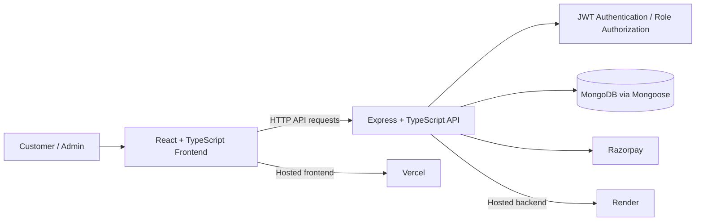

# ShopSphere Architecture

ShopSphere is a full-stack e-commerce application with a customer storefront and an admin interface.

## Technology stack

- **Frontend:** React, TypeScript, Vite, Tailwind CSS
- **Backend:** Node.js, Express, TypeScript
- **Database:** MongoDB with Mongoose
- **Authentication:** JWT and bcrypt
- **Payments:** Razorpay
- **Deployment:** Vercel (frontend) and Render (backend)

## High-level architecture



## Repository layout

```text
ShopSphere/
├── client/             # React + Vite frontend
│   ├── src/
│   └── vercel.json     # SPA rewrite configuration
├── server/             # Express + TypeScript backend
│   ├── src/
│   └── .env.example
└── docs/
    ├── API.md
    └── ARCHITECTURE.md
```

> Update this tree if your repository has additional folders or a different source layout.

## Main application areas

### Customer storefront
- Browse and search products
- View product details
- Manage cart and wishlist
- Manage checkout and payment
- View order history

### Admin interface
- Manage products and categories
- View and manage orders
- Access admin-only functionality through role-protected API routes

## Request flow

1. A customer or admin interacts with the React application.
2. The frontend sends HTTP requests to the backend using the configured API base URL.
3. Express routes dispatch requests to backend handlers.
4. Authentication and authorization middleware protect customer and admin resources.
5. Mongoose reads or writes application data in MongoDB.
6. Payment-related operations integrate with Razorpay; the backend verifies payment before completing the order flow.
7. The API returns a response to the frontend, which updates the interface.

## Security considerations

- Passwords are hashed with bcrypt rather than stored as plaintext.
- JWT-based authentication protects signed-in resources.
- Admin operations are restricted by role-based authorization.
- Validate and sanitize incoming data and validate resource IDs.
- Keep secrets in environment variables; do not commit `.env` files.
- Configure CORS and security headers for the deployed frontend/backend origins.
- Payment verification is handled server-side; do not trust client-side payment status alone.

## Deployment

- **Frontend:** Vercel — `https://shopsphere-coral-rho.vercel.app/`
- **Backend:** Render — `https://shopsphere-22ek.onrender.com`

The frontend uses `VITE_API_URL` to configure the backend API base URL. The backend environment configuration includes values such as `PORT`, `NODE_ENV`, `MONGODB_URI`, `JWT_SECRET`, `RAZORPAY_KEY_ID`, `RAZORPAY_KEY_SECRET`, and `FRONTEND_URL`.

Never place private credentials in frontend environment variables or commit secrets to the repository.
